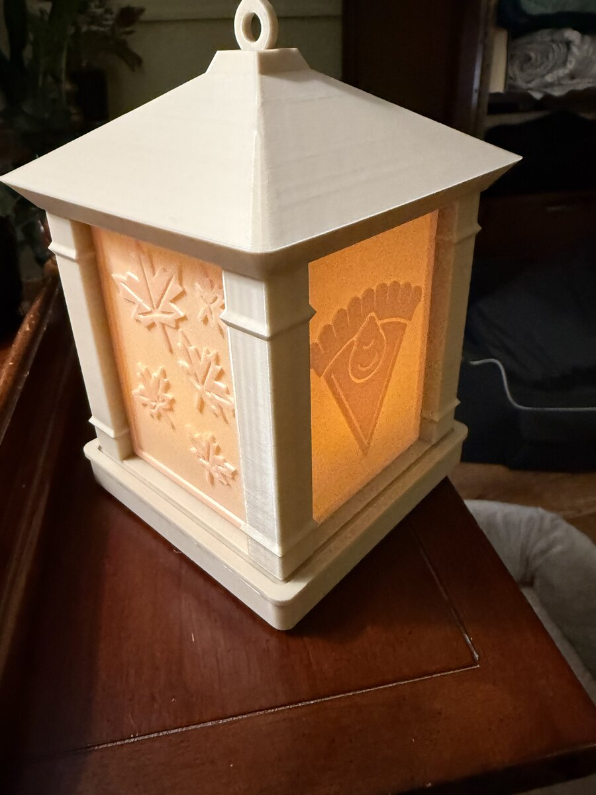

# Lantern — seasonal swap-out panels

All panels are **77.5 × 105 × 1.8 mm**, sized for the measured **78 mm** panel slots
(0.5 mm total width clearance). Solid backlit style: continuous 0.7 mm cream backing
(no through-holes), 1.1 mm amber details, 1.8 mm dark silhouettes, border and rails.

> The 77.5 × 105 × 1.8 mm panels have been printed and fit the lantern well (confirmed by Shannon, Nov 2026). Dimensions and watertight single-body meshes were also verified digitally.

Print flat, relief/rails facing up, 100% scale, no supports, natural/white PLA.
Battery LED tea light only.

## Holidays

| Folder | Panels |
| --- | --- |
| `thanksgiving_panels_for_78mm_slots/` | turkey, cornucopia, pumpkin, falling leaves, pilgrim hat, pumpkin pie (+ optional diagnostic fit strip) |
| `christmas_panels_for_78mm_slots/` | tree, snowman, reindeer, wreath (v6) |
| `new_years_panels_for_78mm_slots/` | fireworks, midnight clock, champagne toast, party hat & streamers (v1) |
| `valentines_panels_for_78mm_slots/` | heart & arrow, rose bouquet, box of chocolates, Cupid (built from approved v2 artwork; files named `valentines_v1_*`) |
| `easter_panels_for_78mm_slots/` | Easter bunny, egg basket, decorated egg, hatching chick (v1) |
| `st_patricks_panels_for_78mm_slots/` | four-leaf clover, leprechaun hat, pot of gold & rainbow, Celtic harp (v1) |
| `july_fourth_panels_for_78mm_slots/` | waving flag (50 stars), fireworks over skyline, bald eagle, Liberty Bell (v2) |
| `halloween_panels_for_78mm_slots/` | jack-o'-lantern, witch across the moon, black cat on fence, haunted house with bats (v1) |

Each holiday folder (except Thanksgiving) also has a `*_backlit_SIMULATED_4up.png` preview.
It is a simulation from the STL thickness, not a photo of a print.

## Photo lithophanes

Photo lithophane panels use the same **77.5 × 105 mm** lantern slots. An OrcaSlicer print-settings template is in [`lithophanes/`](lithophanes/README.md). Open `orcaslicer-lithophane-settings.3mf`, delete the placeholder object if there is one, import a lithophane `.stl`, lay it flat with the back down, and slice with the project / Global settings.

The 77.5 × 105 × 1.8 mm panels have been printed and fit the lantern well (confirmed by Shannon, Nov 2026). Printing vertically can improve image quality but may change the frame thickness slightly.

## Other files

- `source/lantern.scad` — lantern OpenSCAD source.
- `source/<holiday>/` — approved artwork for each holiday: approval sheet, per-panel PNGs,
  SVGs, thickness-class maps (0/127/254 = 0.7/1.1/1.8 mm), pixel→mm transform, build scripts
  and `NOTES_sources_licenses.md` (all third-party references are CC0 / Public Domain).
- `SHA256SUMS` — checksums for the panel files.
- Base, roof and `.3mf` project files at this level are from the original import (PR #1), unchanged.
- [`lithophanes/`](lithophanes/README.md) — OrcaSlicer lithophane print-settings template (`orcaslicer-lithophane-settings.3mf`).
