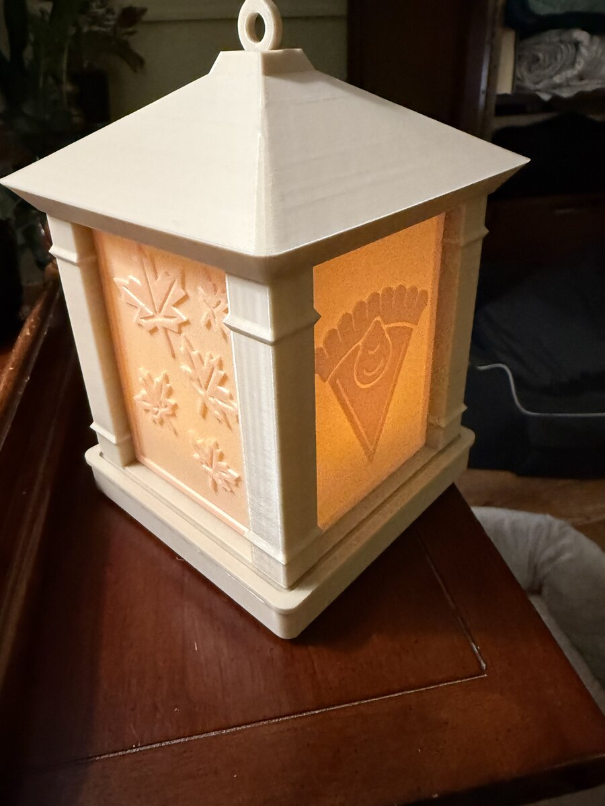

# 3D-Printer
3D Printing projects

## Lantern with seasonal swap-out panels

A printed lantern with backlit panels you can swap for each holiday. The photo shows the Thanksgiving falling-leaves and pumpkin pie panels lit by a battery LED tea light. Panel files, sizes and print settings are in [Lantern/](Lantern/README.md).
